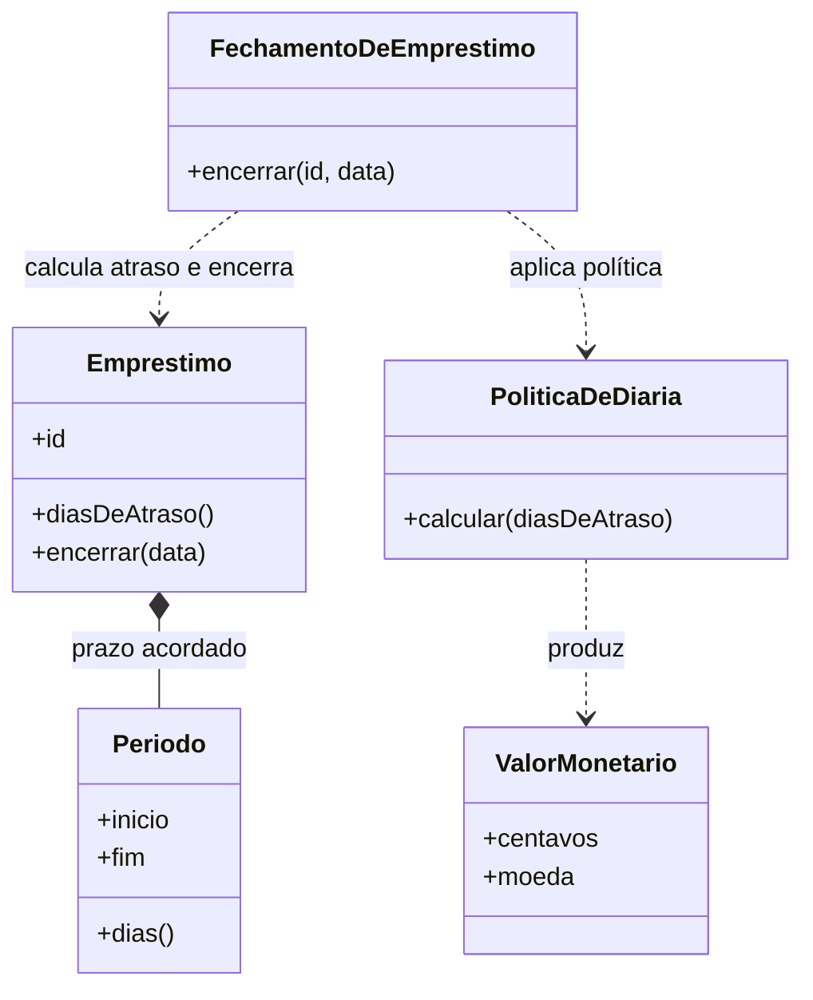
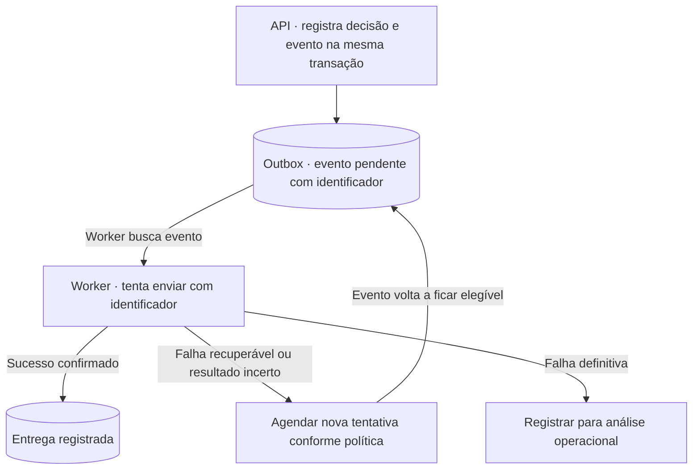
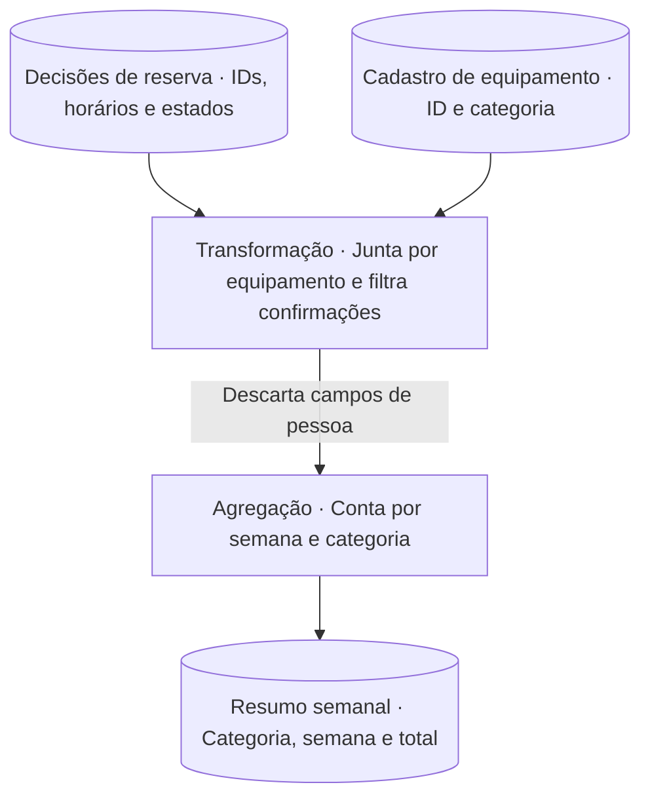
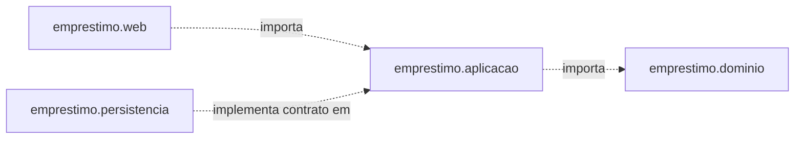
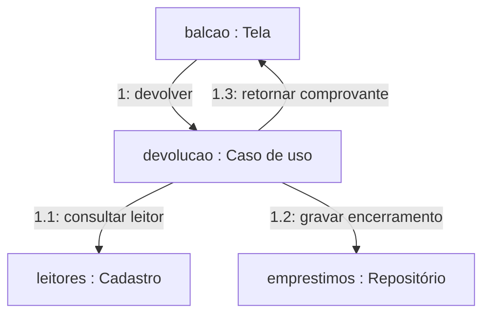
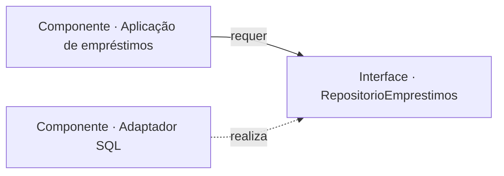

# Mini-escopos complementares

## Classes do domínio

Uma equipe adicionará regras de cálculo de diárias a um acervo de empréstimos. Ela precisa distinguir entidade, objeto de valor e política antes de discutir banco ou interface. Este domínio é fictício e independente do MVP de reservas.

O caso de uso coordena o encerramento. A política calcula o valor a partir do atraso, e o empréstimo protege a regra de encerramento. `Periodo` e `ValorMonetario` modelam conceitos. Para discutir relações e chaves persistidas, use um modelo entidade-relacionamento.

## Fluxo de eventos

Um piloto de notificações usa um worker. Sucesso da decisão e sucesso da entrega são resultados distintos. O time precisa mapear onde um evento pode ser retomado após falha.

O desenho foca a passagem dos eventos. A [implantação do piloto](../exemplos/reservas-de-recursos/diagramas.md#implantação) mostra as unidades, rede e conexões. A recuperação depende da política de retentativa e das garantias de deduplicação oferecidas pela integração.

## Linhagem de dados

Um laboratório fictício quer publicar um resumo semanal de utilização. Operação precisa rastrear de onde saiu cada contagem e excluir dados pessoais da saída.

Registre período, critério de contagem, tratamento de categorias ausentes e uma amostra de conciliação. O leitor pode investigar uma diferença conhecendo a fonte, o filtro e a granularidade da métrica.

## Pacotes

**Mini-escopo.** O código de empréstimos ficou grande o suficiente para a equipe discutir dependências. A regra é que a borda web e o adaptador escrevem contra contratos, enquanto o domínio independe da infraestrutura.

A seta pontilhada aponta para o pacote usado. Essa visão organiza o código e ajuda a revisar imports. A fonte em [PlantUML](pacotes.puml) usa a notação de pacote.

## Comunicação

**Mini-escopo.** No balcão de uma biblioteca fictícia, uma devolução precisa consultar o cartão do leitor e gravar o encerramento. O grupo quer enxergar quais colaboradores falam diretamente e numerar as mensagens.

A numeração expressa a ordem dentro da solicitação. Esta é uma representação de comunicação em Mermaid. Compare com a [sequência de reservas](../exemplos/reservas-de-recursos/diagramas.md#sequência-de-decisão), em que a decisão inclui ramos e persistência transacional.

## Componentes UML

**Mini-escopo.** A equipe do empréstimo quer trocar o armazenamento de testes pelo adaptador SQL e conferir se o contrato continua suficiente. A visão mostra a interface exigida e quem a implementa.

A versão em [PlantUML](componentes.puml) mostra contrato e implementação. Para disponibilidade, rede ou multiplicidade de instâncias, use implantação.
