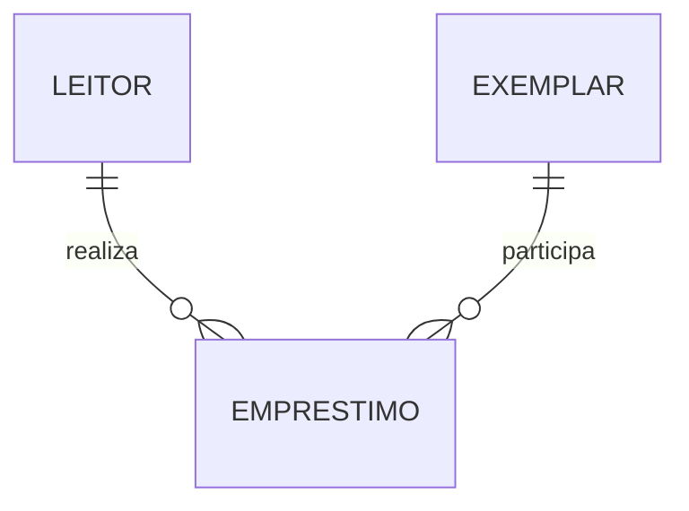
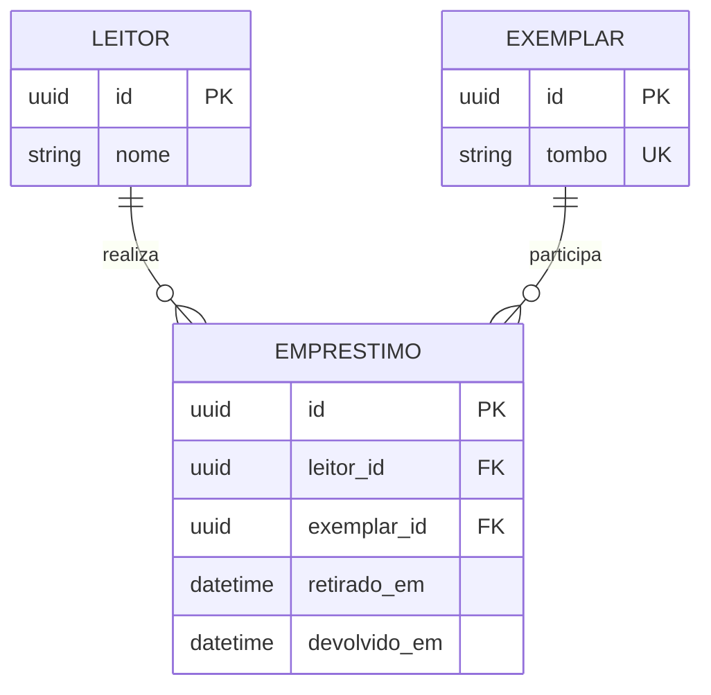

# Modelagem de relações e banco de dados

**Mini-escopo.** Uma biblioteca comunitária registra empréstimos de exemplares físicos. Um leitor pode ter vários empréstimos históricos. Um exemplar também tem vários registros ao longo do tempo, com no máximo um empréstimo ativo por exemplar.

## Modelo conceitual

Na conversa com produto, estabeleça entidades, multiplicidades e regras.




Cada empréstimo tem exatamente um leitor e um exemplar. A relação entre leitor e exemplar é muitos para muitos no histórico, resolvida pela entidade de empréstimo. A unicidade de uma operação ativa é uma regra adicional.

## Modelo lógico

Escolha identificadores, chaves estrangeiras e atributos relevantes. A relação histórica permanece, mesmo depois da devolução.




`devolvido_em` pode ficar ausente enquanto o empréstimo estiver ativo. Chaves estrangeiras e datas válidas devem ser verificadas mesmo quando o dado chega por importação.

## Decisão física ilustrativa em PostgreSQL

Escolha tipos, restrições, índices e estratégia de migração conforme a tecnologia. Admitindo tabela e colunas já criadas, um índice único parcial é uma opção para impedir dois empréstimos ativos do mesmo exemplar.


```sql
CREATE UNIQUE INDEX emprestimo_ativo_por_exemplar
    ON emprestimo (exemplar_id)
    WHERE devolvido_em IS NULL;
```

A condição acima demonstra a regra de empréstimo ativo. Intervalos planejados e sobrepostos de reservas são outra regra e precisam do [modelo de reservas](../exemplos/reservas-de-recursos/diagramas.md#modelo-de-dados) e do [ADR](../exemplos/reservas-de-recursos/adr-001-confirmacao.md). Teste a regra física com duas sessões e dados sintéticos antes de tratá-la como evidência de integridade. [Restrições em PostgreSQL](https://www.postgresql.org/docs/current/ddl-constraints.html) · [Índices parciais](https://www.postgresql.org/docs/current/indexes-partial.html)
