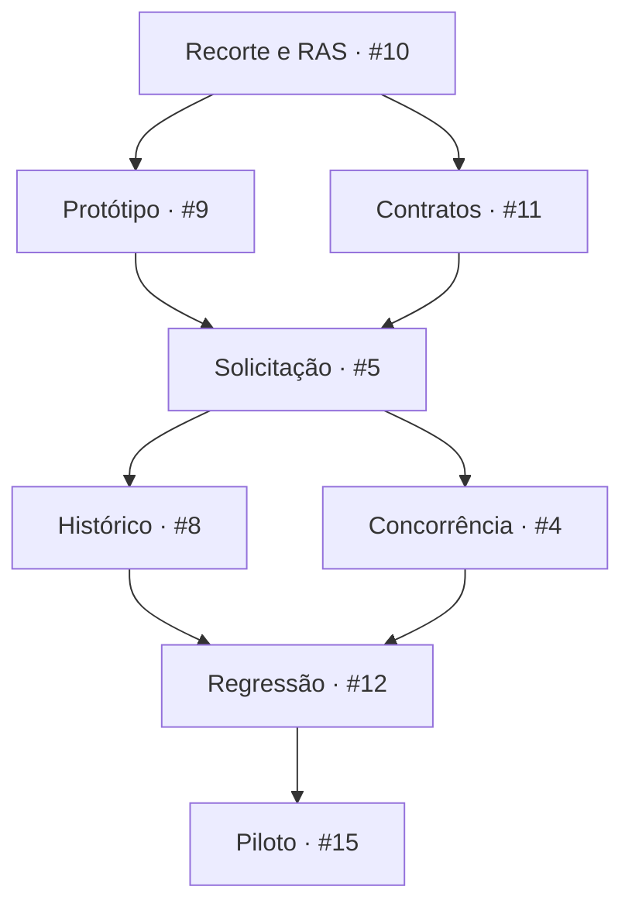

# Project da Base de Projetos

O quadro [Base de Projetos · Acervo e evolução](https://github.com/users/PHnsilva/projects/13) acompanha a manutenção do acervo e serve para estudar um backlog fictício. Use [as issues didáticas](https://github.com/PHnsilva/base-de-projetos/issues?q=is%3Aissue%20label%3Aexemplo) e [as issues de manutenção](https://github.com/PHnsilva/base-de-projetos/issues?q=is%3Aissue%20-label%3Aexemplo) como listas públicas. O Project é privado e contém as 12 issues didáticas, com campos e relações nativas preenchidos, além do PR de evolução do acervo. Sua consulta depende do acesso à conta.

## Camadas do backlog

Sprint é a janela de trabalho. Milestone representa a entrega maior. O caso fictício tem duas entregas e quatro sprints, com dias relativos a uma data inicial escolhida pelo responsável pelo quadro.

O calendário aplicado usa S1 de **23 a 29/11/2026**, S2 de **30/11 a 06/12**, S3 de **07 a 13/12** e S4 de **14 a 20/12**. Essas datas são didáticas. Elas não representam compromisso de implementação do produto. As issues permanecem em Backlog enquanto seus resultados não forem demonstrados.

| Sprint | Objetivo da janela | Milestone |
| --- | --- | --- |
| S1 | Descoberta e desenho | MVP de reservas |
| S2 | Jornada principal | MVP de reservas |
| S3 | Piloto do MVP | MVP de reservas |
| S4 | Evolução | Evolução de reservas |

| Sprint | Issue | Tipo nativo previsto | Funcionalidade | Tamanho / peso | Prioridade | Dias na sprint | Bloqueada por |
| --- | --- | --- | --- | --- | --- | --- | --- |
| S1 | [#10](https://github.com/PHnsilva/base-de-projetos/issues/10) | Task | Planejamento | M / 3 | Alta | 1–3 | — |
| S1 | [#11](https://github.com/PHnsilva/base-de-projetos/issues/11) | Task | Decisão | P / 2 | Alta | 4–6 | [#10](https://github.com/PHnsilva/base-de-projetos/issues/10) |
| S1 | [#9](https://github.com/PHnsilva/base-de-projetos/issues/9) | Task | Solicitação | M / 3 | Média | 4–7 | [#10](https://github.com/PHnsilva/base-de-projetos/issues/10) |
| S2 | [#5](https://github.com/PHnsilva/base-de-projetos/issues/5) | Feature | Solicitação | M / 3 | Alta | 1–3 | [#9](https://github.com/PHnsilva/base-de-projetos/issues/9), [#11](https://github.com/PHnsilva/base-de-projetos/issues/11) |
| S2 | [#4](https://github.com/PHnsilva/base-de-projetos/issues/4) | Bug | Decisão | L / 5 | Alta | 4–7 | [#5](https://github.com/PHnsilva/base-de-projetos/issues/5), [#11](https://github.com/PHnsilva/base-de-projetos/issues/11) |
| S2 | [#8](https://github.com/PHnsilva/base-de-projetos/issues/8) | Feature | Histórico | M / 3 | Média | 4–7 | [#5](https://github.com/PHnsilva/base-de-projetos/issues/5), [#11](https://github.com/PHnsilva/base-de-projetos/issues/11) |
| S3 | [#3](https://github.com/PHnsilva/base-de-projetos/issues/3) | Task | Decisão | P / 2 | Média | 1–4 | [#11](https://github.com/PHnsilva/base-de-projetos/issues/11) |
| S3 | [#12](https://github.com/PHnsilva/base-de-projetos/issues/12) | Task | Operação | M / 3 | Alta | 1–4 | [#4](https://github.com/PHnsilva/base-de-projetos/issues/4), [#8](https://github.com/PHnsilva/base-de-projetos/issues/8), [#11](https://github.com/PHnsilva/base-de-projetos/issues/11) |
| S3 | [#15](https://github.com/PHnsilva/base-de-projetos/issues/15) | Task | Operação | M / 3 | Alta | 5–7 | [#12](https://github.com/PHnsilva/base-de-projetos/issues/12) |
| S4 | [#2](https://github.com/PHnsilva/base-de-projetos/issues/2) | Task | Agenda | M / 3 | Baixa | 1–4 | [#15](https://github.com/PHnsilva/base-de-projetos/issues/15) |
| S4 | [#13](https://github.com/PHnsilva/base-de-projetos/issues/13) | Task | Ciclo de vida | M / 3 | Baixa | 3–6 | [#15](https://github.com/PHnsilva/base-de-projetos/issues/15) |
| S4 | [#14](https://github.com/PHnsilva/base-de-projetos/issues/14) | Task | Notificações | L / 5 | Baixa | 1–7 | [#15](https://github.com/PHnsilva/base-de-projetos/issues/15) |

A [configuração do exemplo](../tools/github-project/reservas.json) contém a ordem, as cores e a janela de cada item. As issues explicam a natureza do trabalho, os critérios e as evidências correspondentes.

O mapa destaca o caminho do piloto. Documentação e preparação de testes podem começar antes das implementações. A seta indica dependência para validar o resultado, não que uma pessoa precisa aguardar para iniciar toda a issue.

## Abas do Project

| Ordem | Aba | Separação principal | O que precisa aparecer |
| --- | --- | --- | --- |
| 1 | Kanban por sprints | Colunas por **Status** e faixas horizontais por **Sprint** | Cartões com Tipo, Prioridade, Tamanho e Funcionalidade. Filtro de itens abertos |
| 2 | Sprints e carga | Tabela agrupada por **Sprint** | Status, Tipo, Prioridade, Tamanho, Peso, datas, marco e responsável quando atribuído. Soma do peso por janela |
| 3 | Roadmap | Linha do tempo por **Início planejado** e **Entrega planejada** | Janelas do MVP e da evolução. Use esta aba quando as datas estiverem preenchidas e o cronograma servir para coordenação |
| 4 | Por funcionalidade | Tabela agrupada por **Funcionalidade** | Sprint, Status, Tipo e Prioridade para encontrar pendências na mesma jornada |
| 5 | Dependências | Tabela de issues bloqueadas, agrupada por **Sprint** | Prioridade, funcionalidade e marco. Abra a issue para consultar os bloqueadores nativos |
| 6 | Evolução do acervo | Tabela de manutenção real, agrupada por **Status** | PRs e issues do próprio acervo, responsável e labels, sem as estimativas fictícias de reservas |

A iteração aparece como cabeçalho de cada faixa no Kanban. É possível ver simultaneamente tarefas de uma sprint em estados diferentes sem trocar de aba. A tabela Sprints e carga compara as janelas. Por funcionalidade encontra a prototipação e a implementação da Solicitação mesmo em sprints distintas. Dependências destaca o que exige uma entrega anterior. Evolução do acervo mantém a revisão real visível sem misturá-la ao calendário do produto fictício.

As cinco views didáticas usam `is:open label:exemplo`. Dependências acrescenta `is:blocked`; o filtro foi conferido contra as relações nativas e retorna 11 issues. O recorte complementar `is:open label:exemplo -is:blocked` retorna apenas #10 neste estado inicial. Conforme os bloqueadores forem concluídos, o conjunto muda. Evolução do acervo usa `is:open -label:exemplo` e inclui a [issue #17](https://github.com/PHnsilva/base-de-projetos/issues/17) e o [PR #16](https://github.com/PHnsilva/base-de-projetos/pull/16) em In review, atribuídos ao mantenedor. O aceite da issue depende da revisão do PR.

Use filtros para exemplos, defeitos e responsáveis sem ocupar abas separadas. Em **Backlog**, mantenha a entrada sem limite de coluna. Use limite de WIP em **In progress** se a equipe tiver um acordo. [Agrupamento e cartões do GitHub](https://docs.github.com/en/issues/planning-and-tracking-with-projects/customizing-views-in-your-project/customizing-the-board-layout)

## Referências para a organização

As seis views atendem perguntas diferentes: estado, carga, prazo, jornada, impedimento e manutenção. Ao adaptar esta base a outro projeto, mantenha somente as perguntas que exigem acompanhamento recorrente. Um filtro ocasional não precisa se tornar uma aba.

| Referência pública | Prática observada | Adaptação nesta base |
| --- | --- | --- |
| [Boas práticas de Projects](https://docs.github.com/en/issues/planning-and-tracking-with-projects/learning-about-projects/best-practices-for-projects) | Views por perspectiva; iterações, campos e soma de estimativas; informações mantidas nas issues e PRs | Sprints e carga, campos nativos e relações sem uma segunda lista manual de bloqueios |
| [GitHub Public Roadmap](https://github.com/orgs/github/projects/4247) e [seu guia](https://github.com/github/roadmap) | Fase de lançamento, área do produto e expectativa de entrega; views para públicos ou fases diferentes | Roadmap e Por funcionalidade respondem a perguntas distintas do Kanban. As datas fictícias são identificadas |
| [Processo de desenvolvimento publicado do VS Code](https://github.com/microsoft/vscode/wiki/Development-Process) | Roadmap de temas, planejamento de iterações e critérios de conclusão com validação | Objetivo por sprint, marco de entrega e evidência ligada ao aceite; a duração e os ritos são adaptados ao recorte de reservas |

Essas referências fundamentam a organização, sem impor seu volume de trabalho, duração de ciclo ou arquitetura ao projeto de destino. A [documentação de dependências](https://docs.github.com/en/issues/tracking-your-work-with-issues/using-issues/creating-issue-dependencies) explica o vínculo nativo e os indicadores de bloqueio.

## Campos e cores

| Campo | Onde aparece | Valores do exemplo |
| --- | --- | --- |
| Tipo | Tipo nativo da issue, exibido no cartão como Type | Task para descoberta, documentação e validação. Feature para comportamento novo. Bug para regressão |
| Sprint | Iteração do Project, usada nas faixas e na tabela | S1 a S4, com sete dias cada |
| Prioridade | Seleção nativa do Project, visível no cartão | Alta em vermelho, Média em amarelo, Baixa em cinza |
| Tamanho | Seleção nativa visível no cartão | P em verde, M em amarelo, L em roxo |
| Peso | Campo numérico, visível na tabela Sprints e carga | P com 2, M com 3 e L com 5 nesta amostra |
| Funcionalidade | Seleção nativa, usada para cartões e agrupamento | Solicitação em azul, Decisão em roxo, Histórico em verde, Operação em laranja, entre outras |
| Início e entrega planejados | Campos de data | Datas calculadas dentro da sprint a partir de um início escolhido |
| Milestone | Campo da issue e da tabela | MVP de reservas ou Evolução de reservas |
| Dependências | Relação nativa **Blocked by** no painel da issue | A dependência liga duas issues da Base. Exemplo de verificação: #4 depende de #5 e #11 |
| Responsável | Assignees da issue quando houver dono acordado | Os exemplos registram papéis esperados para a revisão |

As cores do tipo nativo vêm das opções da conta. "Natureza" no corpo explica o trabalho em mais detalhe sem criar onze tipos. Aplique cores aos campos selecionáveis em vez de repetir categorias nos títulos. [Tipos de issue no GitHub](https://docs.github.com/en/issues/tracking-your-work-with-issues/using-issues/managing-issue-types)

## Aplicação e verificação

A [ferramenta do Project](../tools/github-project/README.md) calcula as sprints e grava campos, cartões, tipos, milestones e dependências quando executada com acesso à conta. O [roteiro das abas](../tools/github-project/README.md#ajustar-as-abas-existentes) detalha os agrupamentos e a verificação visual no quadro.

## Templates no GitHub

O diretório `.github/ISSUE_TEMPLATE` contém a configuração nativa do seletor de novas issues. Os documentos e modelos de engenharia permanecem no [acervo de templates](../templates/projeto/README.md). Para abrir uma issue, use o [seletor do GitHub](https://github.com/PHnsilva/base-de-projetos/issues/new/choose). [Documentação dos templates nativos](https://docs.github.com/en/communities/using-templates-to-encourage-useful-issues-and-pull-requests/configuring-issue-templates-for-your-repository)

## Fluxo e metadados

- **Backlog** guarda demandas candidatas. **Ready** exige objetivo, escopo, aceite, evidência esperada e dependências compreendidas.
- **In progress** representa trabalho em andamento com responsável. Registre bloqueio na relação entre issues e deixe clara a ação para resolvê-lo.
- **In review** exige artefato e evidência que possam ser inspecionados. **Done** exige aceite e rastreabilidade.
- Use checklist para passos com o mesmo aceite. Use dependência entre entregas verificáveis separadamente, como #5 e #8. Sub-issues ajudam quando entregas compõem um mesmo objetivo, como um ensaio de publicação dividido por ambiente.

## Issues didáticas

| Para conferir… | Exemplos |
| --- | --- |
| Descoberta, protótipo e decisão de arquitetura | [#10](https://github.com/PHnsilva/base-de-projetos/issues/10) · [#9](https://github.com/PHnsilva/base-de-projetos/issues/9) · [#11](https://github.com/PHnsilva/base-de-projetos/issues/11) |
| Funcionalidade, concorrência e documentação | [#5](https://github.com/PHnsilva/base-de-projetos/issues/5) · [#8](https://github.com/PHnsilva/base-de-projetos/issues/8) · [#4](https://github.com/PHnsilva/base-de-projetos/issues/4) · [#3](https://github.com/PHnsilva/base-de-projetos/issues/3) |
| Evidência de teste, publicação e operação | [#12](https://github.com/PHnsilva/base-de-projetos/issues/12) · [#15](https://github.com/PHnsilva/base-de-projetos/issues/15) |
| Investigar evolução com limites e hipóteses | [#2](https://github.com/PHnsilva/base-de-projetos/issues/2) · [#13](https://github.com/PHnsilva/base-de-projetos/issues/13) · [#14](https://github.com/PHnsilva/base-de-projetos/issues/14) |

Consulte os [modelos de issue](https://github.com/PHnsilva/base-de-projetos/issues/new/choose) e siga a [matriz de rastreabilidade](../exemplos/reservas-de-recursos/especificacao.md#matriz-de-rastreabilidade) antes de adaptar um exemplo.
