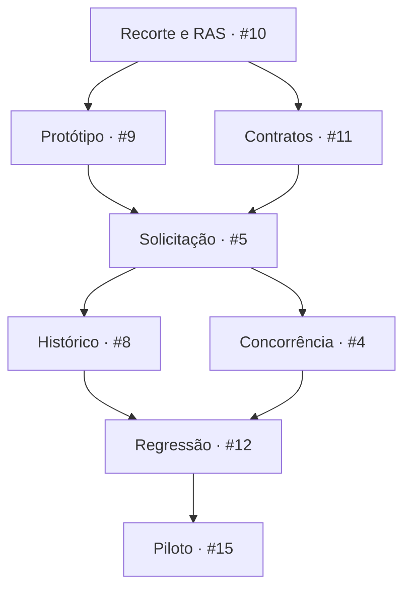

# Project da Base de Projetos

O quadro [Base de Projetos · Acervo e evolução](https://github.com/users/PHnsilva/projects/13) acompanha a manutenção do acervo e serve para estudar um backlog fictício. Use [as issues didáticas](https://github.com/PHnsilva/base-de-projetos/issues?q=is%3Aissue%20label%3Aexemplo) e [as issues de manutenção](https://github.com/PHnsilva/base-de-projetos/issues?q=is%3Aissue%20-label%3Aexemplo) como listas públicas. A presença das issues no quadro e a configuração persistida das views dependem do acesso ao Project.

## Camadas do backlog

As sprints e prioridades são didáticas. A tabela define o plano e as relações de precedência sem datas inventadas. As issues carregam os mesmos dados no título e no corpo.

| Sprint | Marco | Resultado verificável |
| --- | --- | --- |
| S1 | Descoberta e desenho | Recorte, RAS, protótipo e contrato discutidos |
| S2 | Jornada principal | Solicitação e histórico integrados. A regra de concorrência demonstrada |
| S3 | Piloto do MVP | Regressão, documentação de decisão e recuperação revisadas |
| S4 | Evolução | Evidência para decidir sobre agenda, ciclo de vida e notificação |

| Sprint | Issue | Tipo | Porte / peso | Prioridade | Depende de |
| --- | --- | --- | --- | --- | --- |
| S1 | [#10](https://github.com/PHnsilva/base-de-projetos/issues/10) Delimitar o MVP e validar os requisitos que afetam a arquitetura | Descoberta | M / 3 | P0 | — |
| S1 | [#9](https://github.com/PHnsilva/base-de-projetos/issues/9) Validar o protótipo da solicitação e a recuperação dos erros | Experiência | M / 3 | P1 | [#10](https://github.com/PHnsilva/base-de-projetos/issues/10) |
| S1 | [#11](https://github.com/PHnsilva/base-de-projetos/issues/11) Definir as fronteiras entre interface, casos de uso e persistência | Decisão técnica | P / 2 | P0 | [#10](https://github.com/PHnsilva/base-de-projetos/issues/10) |
| S2 | [#5](https://github.com/PHnsilva/base-de-projetos/issues/5) Solicitar reserva e receber o identificador do pedido | Funcionalidade | M / 3 | P0 | [#9](https://github.com/PHnsilva/base-de-projetos/issues/9), [#11](https://github.com/PHnsilva/base-de-projetos/issues/11) |
| S2 | [#4](https://github.com/PHnsilva/base-de-projetos/issues/4) Impedir duas confirmações sobrepostas do mesmo equipamento | Defeito | L / 5 | P0 | [#5](https://github.com/PHnsilva/base-de-projetos/issues/5), [#11](https://github.com/PHnsilva/base-de-projetos/issues/11) |
| S2 | [#8](https://github.com/PHnsilva/base-de-projetos/issues/8) Entregar o histórico com isolamento entre associados | Funcionalidade | M / 3 | P1 | [#5](https://github.com/PHnsilva/base-de-projetos/issues/5), [#11](https://github.com/PHnsilva/base-de-projetos/issues/11) |
| S3 | [#3](https://github.com/PHnsilva/base-de-projetos/issues/3) Documentar decisões e falhas do fluxo de aprovação | Documentação | P / 2 | P1 | [#11](https://github.com/PHnsilva/base-de-projetos/issues/11) |
| S3 | [#12](https://github.com/PHnsilva/base-de-projetos/issues/12) Preparar a regressão integrada de decisão e isolamento | Validação | M / 3 | P0 | [#4](https://github.com/PHnsilva/base-de-projetos/issues/4), [#8](https://github.com/PHnsilva/base-de-projetos/issues/8), [#11](https://github.com/PHnsilva/base-de-projetos/issues/11) |
| S3 | [#15](https://github.com/PHnsilva/base-de-projetos/issues/15) Ensaiar publicação e recuperação do piloto de reservas | Operação | M / 3 | P0 | [#12](https://github.com/PHnsilva/base-de-projetos/issues/12) |
| S4 | [#2](https://github.com/PHnsilva/base-de-projetos/issues/2) Decidir quando integrar uma agenda externa | Investigação | M / 3 | P2 | [#15](https://github.com/PHnsilva/base-de-projetos/issues/15) |
| S4 | [#13](https://github.com/PHnsilva/base-de-projetos/issues/13) Especificar expiração e cancelamento sem alterar o estado do MVP | Evolução | M / 3 | P2 | [#15](https://github.com/PHnsilva/base-de-projetos/issues/15) |
| S4 | [#14](https://github.com/PHnsilva/base-de-projetos/issues/14) Validar entrega assíncrona do e-mail de decisão | Experimento | L / 5 | P2 | [#15](https://github.com/PHnsilva/base-de-projetos/issues/15) |

O mapa destaca o caminho do piloto. Documentação e preparação de testes podem começar antes das implementações. A seta indica dependência para validar o resultado, não que uma pessoa precisa aguardar para iniciar toda a issue.

## Três views para o mesmo quadro

| View | Configuração proposta | Decisão que facilita |
| --- | --- | --- |
| Kanban | Quadro por Status. Use Sprint como filtro quando precisar isolar uma janela | Acompanhar o trabalho em andamento e distinguir bloqueio de acúmulo |
| Sprints | Tabela agrupada por Sprint, com prioridade, peso, status e marco | Ver quanto cabe em cada incremento e conferir a sequência de validação |
| Por funcionalidade | Tabela agrupada por capacidade, com Sprint, tipo e status | Encontrar o que falta para Solicitação, Decisão, Histórico ou Operação |

O tipo de trabalho e a origem didática são filtros aplicáveis às três views. Use `label:exemplo` para o caso fictício. Use `-label:exemplo` para manutenção quando houver itens nesse recorte. Uma view de cronograma vale quando existem datas a revisar. Itens atribuídos e defeitos podem ser recortes da tabela ou do Kanban.

No Kanban, deixe **Backlog** sem limite para representar demanda candidata. Um limite de WIP pode ajudar em **In progress** quando a equipe define o número. O GitHub destaca a ultrapassagem do limite sem impedir novos cartões. [Limites por coluna](https://docs.github.com/en/issues/planning-and-tracking-with-projects/customizing-views-in-your-project/customizing-the-board-layout) · [Filtros](https://docs.github.com/en/issues/planning-and-tracking-with-projects/customizing-views-in-your-project/filtering-projects)

## Campos e relações no GitHub

| Dado | Onde fica quando configurado | Convenção deste caso |
| --- | --- | --- |
| Tipo | Labels no repositório pessoal e campo de seleção no Project se a equipe precisar agrupar por tipo | Funcionalidade, Descoberta, Experiência, Decisão técnica, Defeito, Documentação, Validação, Operação, Investigação, Evolução ou Experimento |
| Sprint | Campo de iteração no Project | S1 a S4 com datas acordadas antes de popular cronograma |
| Marco | Milestone do repositório | Quatro resultados descritos na tabela de sprints |
| Porte | Campo de seleção no Project | P, M e L |
| Peso | Campo numérico no Project | P vale 1–2, M vale 3, L vale 5 nesta amostra |
| Prioridade | Campo de seleção no Project | P0 bloqueia o objetivo da sprint, P1 sustenta o incremento, P2 vale refinar para evolução |
| Capacidade | Campo de seleção no Project | Solicitação, Decisão, Histórico e Operação. Itens transversais podem ter uma categoria própria |
| Dependência | Relação nativa **Blocked by** entre issues | Use os números da tabela. Uma relação indica precedência real para aceitar a entrega |

A tabela e os corpos das issues registram o planejamento disponível publicamente. A aplicação de campos, milestones, relações nativas, filtros e limite de coluna requer configuração no quadro e repositório. Use relações de bloqueio quando um resultado precisa existir para validar outro. Um link de contexto continua suficiente para referências sem bloqueio.

## Templates no GitHub

O diretório `.github/ISSUE_TEMPLATE` contém a configuração nativa do seletor de novas issues. Os documentos e modelos de engenharia permanecem no [acervo de templates](../templates/projeto/README.md). Para abrir uma issue, use o [seletor do GitHub](https://github.com/PHnsilva/base-de-projetos/issues/new/choose). [Documentação dos templates nativos](https://docs.github.com/en/communities/using-templates-to-encourage-useful-issues-and-pull-requests/configuring-issue-templates-for-your-repository)

## Fluxo e metadados

- **Backlog** guarda demandas candidatas. **Ready** exige objetivo, escopo, aceite, evidência esperada e dependências compreendidas.
- **In progress** representa trabalho em andamento com responsável. Registre bloqueio na relação entre issues e deixe clara a ação para resolvê-lo.
- **In review** exige artefato e evidência que possam ser inspecionados. **Done** exige aceite e rastreabilidade.
- Use checklist para passos com o mesmo aceite. Use dependência entre entregas verificáveis separadamente, como #5 e #8. Sub-issues ajudam quando entregas compõem um mesmo objetivo, como um ensaio de publicação dividido por ambiente.

## Issues didáticas

| Para conferir… | Exemplos |
| --- | --- |
| Descoberta, protótipo e decisão de arquitetura | [#10](https://github.com/PHnsilva/base-de-projetos/issues/10) · [#9](https://github.com/PHnsilva/base-de-projetos/issues/9) · [#11](https://github.com/PHnsilva/base-de-projetos/issues/11) |
| Funcionalidade, concorrência e documentação | [#5](https://github.com/PHnsilva/base-de-projetos/issues/5) · [#8](https://github.com/PHnsilva/base-de-projetos/issues/8) · [#4](https://github.com/PHnsilva/base-de-projetos/issues/4) · [#3](https://github.com/PHnsilva/base-de-projetos/issues/3) |
| Evidência de teste, publicação e operação | [#12](https://github.com/PHnsilva/base-de-projetos/issues/12) · [#15](https://github.com/PHnsilva/base-de-projetos/issues/15) |
| Investigar evolução com limites e hipóteses | [#2](https://github.com/PHnsilva/base-de-projetos/issues/2) · [#13](https://github.com/PHnsilva/base-de-projetos/issues/13) · [#14](https://github.com/PHnsilva/base-de-projetos/issues/14) |

Consulte os [modelos de issue](https://github.com/PHnsilva/base-de-projetos/issues/new/choose) e siga a [matriz de rastreabilidade](../exemplos/reservas-de-recursos/especificacao.md#matriz-de-rastreabilidade) antes de adaptar um exemplo.
