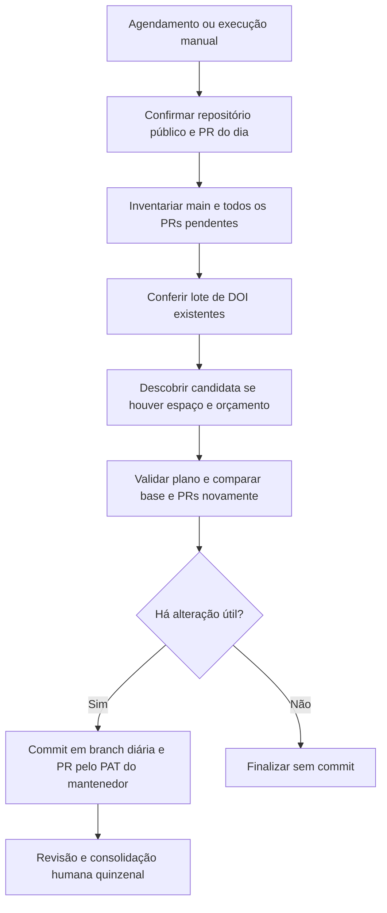

# Contribuição diária e refinamento do conhecimento

## Atualização de 28/11/2026

A cada data de Brasília, a rotina propõe **um PR com relatório de validação executada**, mesmo sem novidade bibliográfica. `reports/daily/AAAA-MM-DD.json` registra o SHA da main, execução do Actions, testes do projeto, validação de links e catálogo, verificação de diff, PRs pendentes e próxima ação. Falhas são registradas como falhas, sem declarar aprovação. Os arquivos são independentes por dia e podem ser revisados em lote; não há merge automático.

A consulta Crossref continua como complemento de até duas fichas por PR. A indisponibilidade da fonte não impede o relatório local. O antigo limite de 14 PRs deixa de bloquear o relatório diário; ao atingir esse volume, novas descobertas bibliográficas são suspensas. O acervo de relatórios cresce diariamente e pode ser consolidado pelo mantenedor.

Tentativas: **04h35, 08h35, 14h35 e 19h35 de Brasília**. A primeira publicação reserva a data; as demais não duplicam PRs, inclusive fechados ou integrados. Token inválido, indisponibilidade do GitHub, mudança da base durante publicação ou falha do runner ainda podem impedir a entrega. A rotina não promete melhoria inédita de código diariamente: a contribuição mínima é a evidência real das verificações.

Esta atualização substitui os trechos históricos abaixo que dizem não registrar verificações, limitar a 14 relatórios ou executar somente duas vezes por dia. Quatro jobs de até 15 minutos equivalem a um teto planejado de 60 minutos/dia; execuções que encontram o PR do dia terminam cedo. A ativação continua dependendo de integrar este PR na main.

Entrega da [issue #18](https://github.com/PHnsilva/base-de-projetos/issues/18). A rotina propõe mudanças bibliográficas verificáveis em PRs e preserva a revisão, aprovação e integração exclusivamente com o mantenedor. Executa em GitHub Actions com o computador desligado, sem ChatGPT/Codex abertos e sem IA durante as execuções.

## Requisitos e recorte aceito

| Necessidade | Comportamento e critério verificável |
| --- | --- |
| Conhecimento útil e rastreável | Prioridade à indexação e manutenção das referências existentes; DOI consultado individualmente, autoria, data, veículo, editora, membro depositante e fonte obrigatórios |
| Descoberta limitada | Até uma candidata por execução, três por semana civil de Brasília, 60 candidatas no catálogo e oito por tema, contando propostas pendentes |
| Atualização e organização | Mudanças substantivas de metadados, classificação por título, relações entre versões e possíveis títulos duplicados geram propostas; contagens de citação e datas de checagem não geram commits |
| Integridade científica | Consulta reversa de avisos editoriais; retratação, correção e relações de versão pedem avaliação humana. Nenhuma resenha, conclusão ou avaliação metodológica é gerada |
| Clássicos e autoria | Idade não é critério de remoção. Resenhas e fontes marcadas como protegidas recebem aviso contextual, preservando o texto |
| Convivência com PRs | Todos os PRs abertos são paginados; seus arquivos, conteúdo, DOI e fichas reservam os respectivos objetos. Inventário incompleto impede publicação |
| Revisão quinzenal | Até 14 PRs diários abertos; ao atingir o limite, aguarda consolidação humana. Nenhum merge, review, aprovação ou fechamento automático |
| Contribuições legítimas | No máximo um PR por data de Brasília, branch independente e identificação `[automated]`. Nenhuma mudança válida significa nenhum commit/PR |
| Independência e custo | Runner Linux padrão público; apenas APIs gratuitas; sem tokens de IA, instalações de serviços, cache ou upload de artifacts |

Uma ficha estruturada de referência existente acrescenta uma representação reutilizável e rastreável para ferramentas e agentes; não é apenas um registro de que um job rodou. A representação registra o que o Crossref informou, mesmo quando a fonte possui título abreviado ou autoria incompleta, sem substituir a bibliografia autoral mais completa.

## Arquitetura e decisões

O repositório já utiliza Node.js e Markdown, sem um pacote npm central. A implementação usa Node.js 24 e sua biblioteca padrão. Isso reduz dependências e mantém os testes executáveis com as ferramentas existentes. A rotina não importa arquivos de PR, não interpreta instruções em publicações e não executa conteúdo remoto.

1. **Crossref como fonte inicial.** O acesso público não exige conta, chave ou pagamento. A API oferece dados depositados por membros e avisos de editoras/Retraction Watch. O campo `member` indica procedência do depósito; não certifica reputação, correção dos dados ou qualidade científica. Não há lista fechada de grandes editoras. [API e condições de reutilização](https://www.crossref.org/documentation/retrieve-metadata/rest-api/)
2. **Busca conservadora.** Rotação diária entre 11 domínios. Busca por título, últimos três anos para descoberta, até 15 resultados; títulos precisam conter um sinal temático e um termo como survey, systematic review, mapping study, benchmark ou replication. São sinais de triagem, não comprovação da metodologia. Referências já existentes são verificadas independentemente da idade. A seleção prioriza obras de síntese ou avaliação, mas perde textos com títulos menos explícitos e idiomas fora das regras iniciais.
3. **Fichas JSON por DOI.** Em `referencias/catalogo/`, um hash do DOI define o caminho canônico. Não há um índice global alterado todos os dias, evitando conflitos de append. As fichas registram origem, autores, data parcial, veículo, editora, temas, links de procedência, locais citados, avisos e relações. Consumidores podem usar [a consulta JSON](../tools/knowledge/catalog.mjs). O catálogo existente e as resenhas continuam sendo a navegação humana; a descoberta é uma fila que exige leitura.
4. **Manutenção antes de crescimento.** Janela rotativa de até 16 DOI existentes por dia, até três alterações por PR. A rotação usa a data, dispensando commits de cursor. Descoberta só acontece se sobrarem vaga, cota e tempo. Contagens de citação são voláteis e não entram na ficha nem geram classificação de prestígio. Limites são revisados na política por PR, sem autorização para ultrapassar automaticamente o teto.
5. **Retrações sem inferência reversa.** `filter=updates:DOI` encontra avisos sobre a referência. `update-to` no aviso aponta para o DOI original, não o contrário. Avisos geram ações justificadas de revisão, correção ou consideração de remoção/substituição. Uma relação de versão permite sugerir comparação; não declara que o texto novo é melhor. Remoções e alterações de resenhas ficam para a revisão humana. Avisos históricos não são apagados só porque uma resposta futura os omitiu. [Dados e limites do Retraction Watch](https://www.crossref.org/documentation/retrieve-metadata/retraction-watch/)
6. **Publicação própria via REST.** Git trees/commits/refs criam uma única branch `automation/knowledge/AAAA-MM-DD`, sem atualizar refs existentes. O token é confirmado por `/user`; nome e endereço noreply da conta são usados no commit. Não é necessário conceder permissões de Workflows, Actions, Administration, Issues ou Projects ao PAT.

### Alternativas consideradas

| Alternativa | Benefício | Decisão e custo de manutenção |
| --- | --- | --- |
| Python com bibliotecas de bibliografia | Ecossistema amplo | Node padrão atende o recorte e já existe no acervo; evita outro runtime e dependências |
| BibTeX único ou arquivo JSON central | Intercâmbio simples | Um arquivo por DOI reduz conflitos entre quinze dias de PRs; exportação BibTeX pode ser acrescentada conforme demanda real |
| GitHub App para publicar | Credencial curta e permissões isoladas | PR seria do App/bot; o requisito de autoria como PHnsilva favorece PAT restrito |
| `GITHUB_TOKEN` para publicar | Token efêmero, sem segredo persistente | Autoria do PR seria do bot; é usado apenas para leitura em simulação. Política de triggers também difere. [Documentação](https://docs.github.com/en/actions/concepts/security/github_token) |
| OpenAlex | Cobertura e grafo de relações maiores | API tem orçamento de uso e planos pagos; não é necessária no caminho inicial de custo zero inequívoco. Nenhuma chave ou conta criada. [Preços oficiais](https://help.openalex.org/access/pricing/) |
| arXiv e DBLP | Preprints de IA e bibliografia de computação | Requerem normalização e deduplicação entre versões/fontes; ficam para um adaptador futuro com testes e termos verificados. Preprint não seria rotulado como revisão por pares |
| Dataset CSV do Retraction Watch | Via alternativa aos avisos da API | Download integral diário aumentaria dados e tempo; API inicial é suficiente para avisos registrados, com cobertura explicitamente incompleta. Usar CSV em investigação humana quando houver suspeita ou indisponibilidade da indexação |
| Resenhas com LLM, leitura de texto integral ou ranking por editora | Mais síntese ou volume | Excluídos: tokens/custo, direitos de texto integral e impossibilidade de fundamentar avaliações automaticamente |

## Tempo, retries e recuperação

O workflow principal agenda **07h35 UTC (04h35 Brasília)** e **17h35 UTC (14h35 Brasília)**. A contingência executa as mesmas verificações e termina cedo se qualquer PR daquela branch diária já existir, inclusive fechado ou integrado. Assim, não reabre uma proposta rejeitada nem cria um segundo PR no dia. Um PR manualmente invalidado requer inspeção do mantenedor, sem contornar sua decisão.

O job inteiro tem timeout de **15 minutos**. O processo reserva **9 minutos** para inventário/buscas e até **4 minutos adicionais** para validação/publicação, com timeout externo de 13 minutos; checkout, setup e testes usam a margem restante. Reduzir o limite flexível proposto de dez para nove minutos protege a publicação e mantém o limite absoluto. Uma busca incompleta é descartada; mudanças já validadas continuam no plano. Se o próprio GitHub encerrar o runner antes da publicação, a próxima execução recalcula o plano. Não se grava estado artificial para preservar um cursor.

Há um grupo de concorrência único, sem cancelar uma publicação em andamento. Leituras têm até três tentativas, timeout de até 15 segundos por requisição, respostas de até 8 MB e paginação limitada com falha explícita em inventário incompleto. Crossref é consultado sequencialmente, com espaçamento mínimo de 1,1 segundo e respeito aos headers de rate limit. `Retry-After` e reset de rate limit são respeitados; esperas acima de 30 segundos encerram aquela consulta, sem usar a reserva de publicação. Escritas não recebem retry cego porque uma resposta perdida pode ter sido aplicada.

Base e heads dos PRs são comparados novamente antes de criar a branch e antes de abrir o PR. Se mudarem, a rotina interrompe e aguarda a próxima execução. Não há garantia transacional contra uma edição humana nos milissegundos seguintes à última consulta; arquivos independentes e revisão humana reduzem esse risco.

Se houver branch diária sem PR após uma interrupção, a próxima execução verifica mensagem, identidade de autor/committer, um único commit, parentesco, ausência de divergência da main, apenas fichas válidas e conflitos pendentes, e abre o PR correspondente. Não atualiza nem força a branch. Uma branch órfã cuja base avançou ou cuja validade não pode ser comprovada exige inspeção humana. Não são criadas branches novas para compensar dias passados.

## Custo e segurança

O repositório foi confirmado público e independente de fork. Runners padrão do GitHub em repositórios públicos permanecem gratuitos; larger runners são cobrados. Ambos os workflows fixam `ubuntu-24.04` e recusam repositórios privados. Não armazenam artifacts nem caches e não usam custom images, serviços externos pagos, Copilot ou LLM. O planejamento de duas execuções de até 15 minutos corresponde a até **30 min/dia e 930 min em 31 dias**; CI de PRs e execuções manuais são adicionais, também no runner público gratuito. Esse valor é planejamento, não uma cota de faturamento configurada. Nenhum faturamento foi habilitado. [Cobrança oficial de Actions](https://docs.github.com/en/billing/concepts/product-billing/github-actions)

Os Actions são oficiais e fixados por SHA. Checkout não persiste credenciais. O `GITHUB_TOKEN` tem somente leitura; o PAT aparece apenas na etapa de publicação. Clientes de APIs científicas não recebem o PAT. URLs de conteúdo não são seguidas, redirecionamentos HTTP são rejeitados e código de PRs pendentes não é executado. CI usa `pull_request`, sem secrets ou `pull_request_target`.

Um fine-grained PAT com Contents write pode tecnicamente escrever conteúdo em outras branches do único repositório autorizado. A restrição à branch diária é aplicada pelo código; o GitHub não oferece um escopo de PAT por prefixo de branch. Regras de proteção da main são uma camada separada, cuja configuração não foi alterada. A integração disponível não conseguiu ler a proteção clássica da branch (403); a consulta de rulesets retornou lista vazia. Não se declara a main protegida com base nesse resultado.

Metadados Crossref são reutilizáveis conforme seus termos; abstracts podem ter direitos específicos e não são copiados. Apenas metadados bibliográficos e links são persistidos. A licença autoral do repositório permanece aplicável ao código da ferramenta.

## Ativação pelo mantenedor, após integrar o PR

1. Revise e integre o PR de implementação na `main`. Nenhuma integração é realizada pela automação. Os agendamentos só funcionam com o arquivo na branch padrão.
2. Abra [criar fine-grained PAT](https://github.com/settings/personal-access-tokens/new). Configure:
   - **Token name:** `base-de-projetos-knowledge-sync`.
   - **Resource owner:** `PHnsilva`.
   - **Expiration:** 90 dias, ou prazo menor conforme sua política. Agende a renovação no seu processo de revisão; expiração interrompe publicação, sem fallback para bot.
   - **Repository access:** Only select repositories → `PHnsilva/base-de-projetos`.
   - **Repository permissions:** Contents → Read and write; Pull requests → Read and write; Metadata → Read-only (automático). Demais permissões: No access; nenhuma Account permission.
   - **Generate token.** Copie o valor diretamente para o Secret abaixo; nunca o envie pelo chat, issue, log ou arquivo versionado. [Documentação dos PATs](https://docs.github.com/en/authentication/keeping-your-account-and-data-secure/managing-your-personal-access-tokens)
3. Em [Actions Secrets do repositório](https://github.com/PHnsilva/base-de-projetos/settings/secrets/actions), escolha **New repository secret**: Name = `KNOWLEDGE_SYNC_TOKEN`; Secret = o valor gerado. Salve.
4. Em [Actions Variables](https://github.com/PHnsilva/base-de-projetos/settings/variables/actions), crie **New repository variable**: Name = `KNOWLEDGE_REFINEMENT_ENABLED`; Value = `true`. Essa chave habilita o agendamento; antes disso, ele é ignorado. Use `false` para suspender novas execuções programadas. Não é necessário divulgar ou enviar o token ao Codex.
5. Confira [Settings → Actions → General](https://github.com/PHnsilva/base-de-projetos/settings/actions): Actions permitidas e actions oficiais de checkout/setup-node autorizadas. Mantenha permissões padrão do `GITHUB_TOKEN` em leitura. A opção “Allow GitHub Actions to create and approve pull requests” **não precisa ser habilitada** para o PAT; nenhuma aprovação será feita.
6. Abra [Daily knowledge refinement](https://github.com/PHnsilva/base-de-projetos/actions/workflows/daily-knowledge-refinement.yml) → **Run workflow** → branch `main` → `publish` desmarcado. Confira resumo e logs. Depois execute novamente com `publish` marcado para validar a publicação real de uma melhoria, caso exista.
7. No primeiro PR real, confira `author: PHnsilva`, prefixo da branch, `[automated]`, fontes e diff útil. O sucesso desse teste e a atribuição real do PR dependem do PAT; os testes simulados não os substituem.

Para contribuir no perfil, o **autor autenticado do PR** deve ser PHnsilva; assignee e autor do commit, isoladamente, não resolvem essa exigência. Abrir PR em repositório independente pode contar antes do merge. Commits em branch de trabalho só contam quando satisfazem os critérios de branches do GitHub. A rotina não garante sequência diária: pode não haver melhoria legítima, ocorrer atraso/queda de agendamento, indisponibilidade, expiração do token ou desativação após 60 dias sem atividade. Horários escolhidos ficam no mesmo dia em UTC e Brasília; atrasos ainda podem atravessar a data. [Critérios de contribuições](https://docs.github.com/en/account-and-profile/reference/profile-contributions-reference) · [Limitações do agendamento](https://docs.github.com/en/actions/reference/workflows-and-actions/events-that-trigger-workflows#schedule)

## Revisão e consolidação quinzenal

O mantenedor pede ao Codex a consolidação em uma nova issue/branch/PR focados, partindo da main atual. A rotina não agenda IA nem dispara essa consolidação.

1. Inventariar todos os PRs `automation/knowledge/`, inclusive suas revisões humanas; comparar os DOI com a main e com os outros PRs.
2. Unir as fichas por DOI, resolver conflitos substantivos consultando fontes, preservar avisos e separar referência indexada de candidata ainda sem leitura. Não escolher cegamente o arquivo mais recente.
3. Conferir títulos equivalentes, versões, avisos editoriais e utilidade por tema. Recusar redundâncias e preservar contexto dos clássicos. Executar os testes e o validador de links/catálogo.
4. No PR consolidado, ligar todos os PRs de origem e justificar inclusões, correções, substituições e eventuais remoções. Mudanças no texto autoral exigem leitura crítica própria.
5. Registrar DOI rejeitado em `tools/knowledge/policy.json` → `excludedDois` para evitar redescoberta futura; não remover da lista apenas por idade. Proteger outras obras em `protectedDois` quando necessário.
6. Somente o mantenedor revisa, aprova e integra. Fechar PRs substituídos ou eliminar branches exige instrução explícita dele; a automação diária nunca o fará.

## Limitações e retomada

A cobertura inicial é de referências com DOI Crossref citados nos Markdown versionados e de candidatas encontradas pelas regras de título. Referências sem DOI, livros sem registro adequado, normas e páginas técnicas continuam válidas e preservadas, mas não recebem validação científica ou vigilância de versões por scraping. Não são inventadas datas para páginas sem data. A classificação pode ficar vazia para títulos pouco descritivos; não se infere o conteúdo do artigo.

Crossref pode conter metadados incompletos e atrasos nos avisos. A inexistência de aviso não certifica integridade. Houve um incidente de indexação de Retraction Watch resolvido em 26/11/2026, reforçando essa limitação; para dúvida concreta consulte fonte editorial/dataset oficial. [Status da fonte](https://status.crossref.org/)

Para retomar desenvolvimento, leia esta decisão, a [evidência de validação](knowledge-refinement-validation.md), a issue #18, a política e os PRs abertos. O PR #16 de documentação foi consultado e preservado; este trabalho não incorpora suas mudanças nem altera seus arquivos compartilhados. Ampliação de fontes ou avaliação de qualidade exige uma nova issue com dados, termos de uso e testes próprios.
