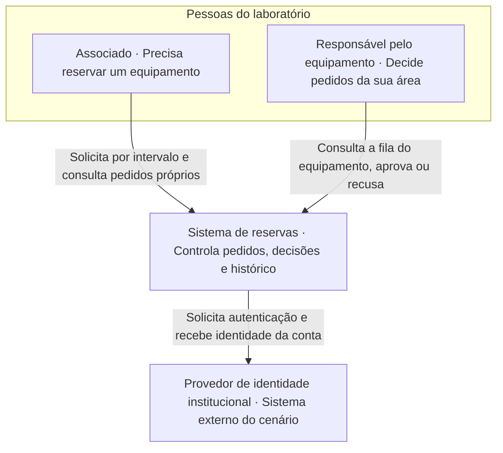
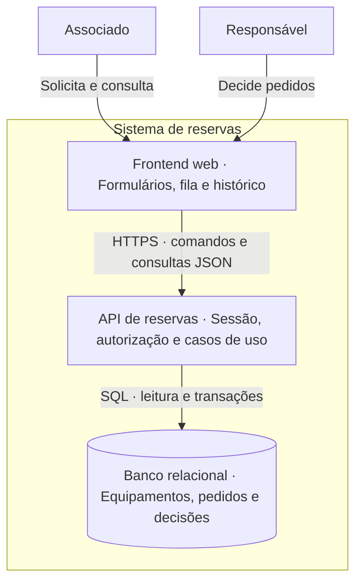
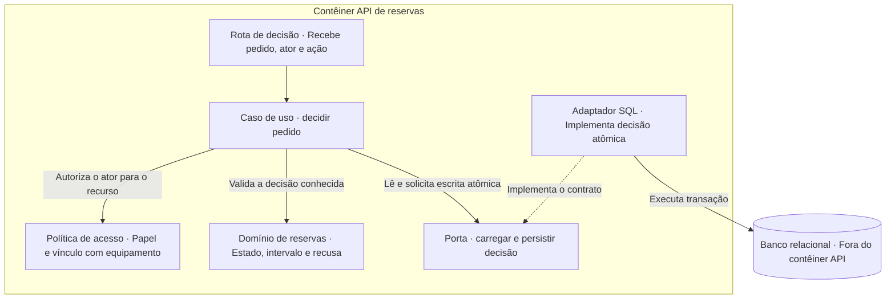
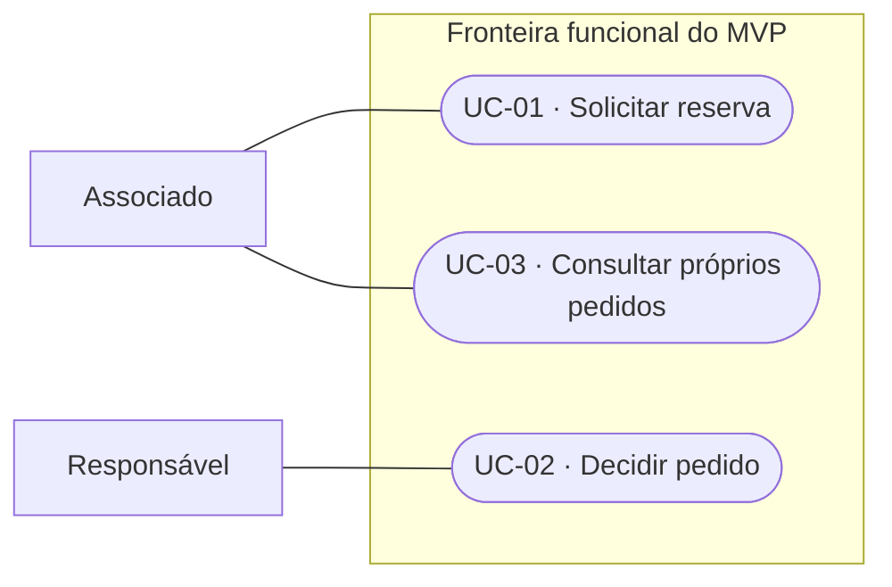
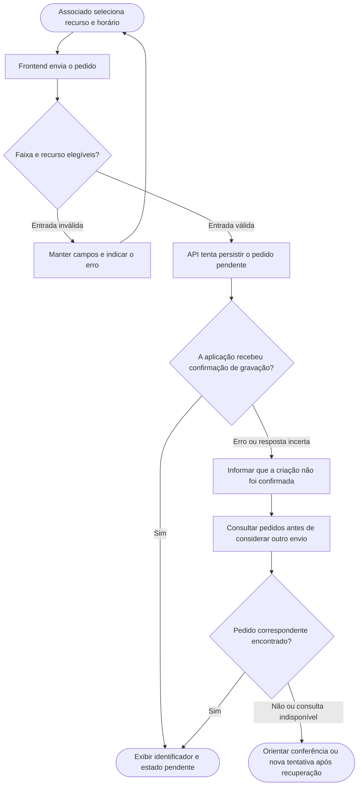
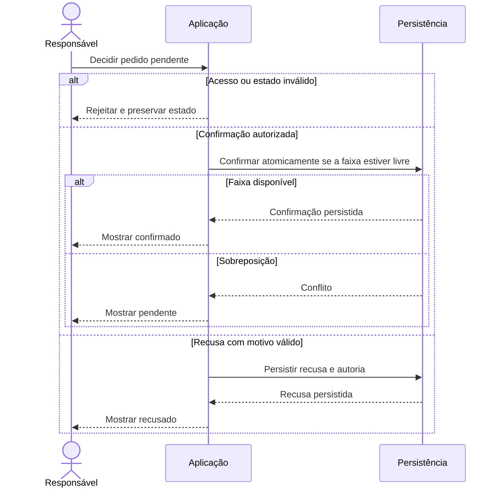
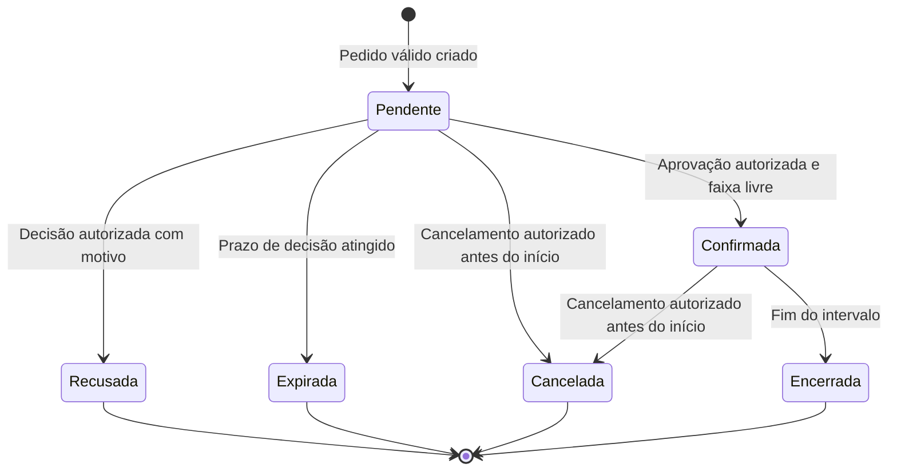
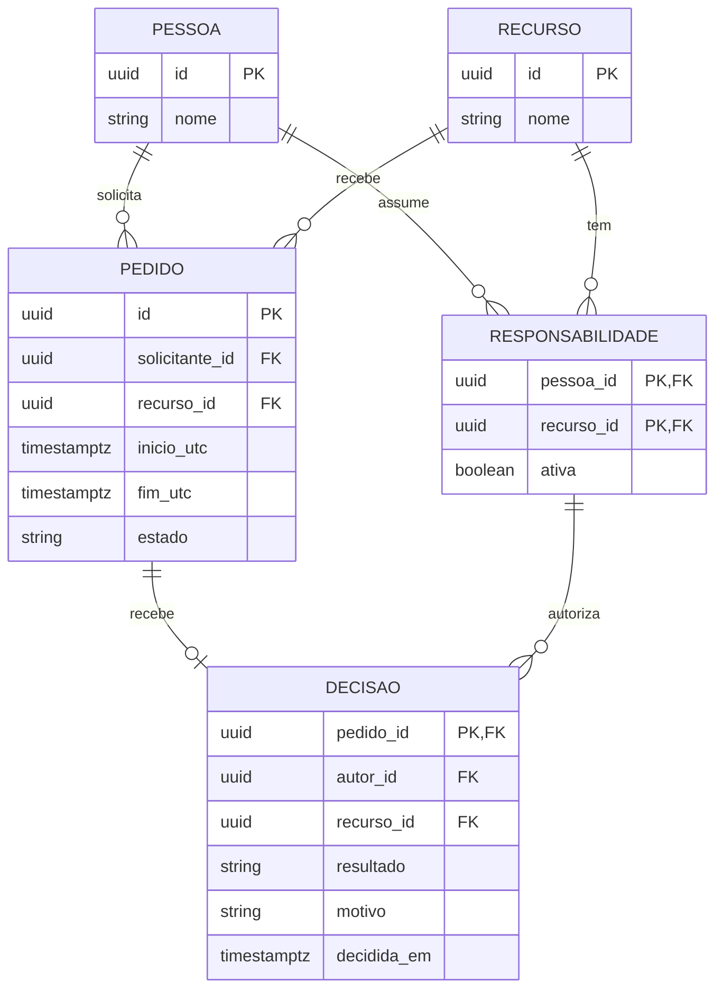
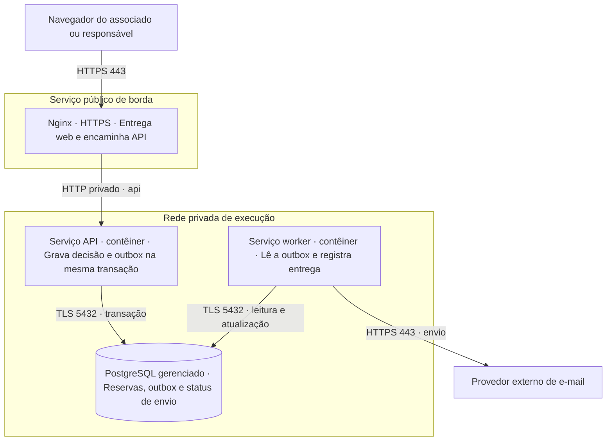
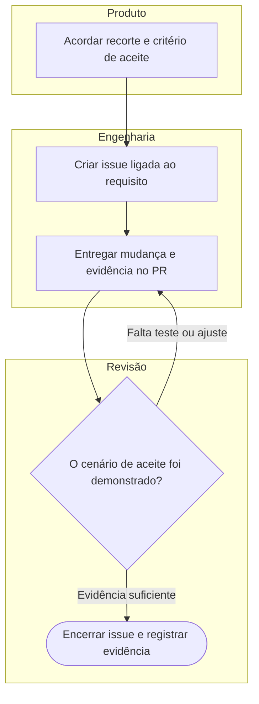

# Diagramas de reservas

Cada exemplo começa com uma situação de projeto, o recorte relevante e a decisão que a equipe precisa tomar. As primeiras visões partem do [MVP de reservas](especificacao.md). Os cenários de evolução vêm identificados em cada seção.

| Se você precisa revisar… | Vá para |
| --- | --- |
| Escopo com a coordenação ou com quem integra o sistema | [Contexto](#contexto) · [Casos de uso](#casos-de-uso) |
| Divisão técnica com frontend e backend | [Contêineres](#contêineres) · [Componentes](#componentes-do-backend) |
| Comportamento com usuários e testes | [Fluxo](#fluxo-de-solicitação) · [Sequência](#sequência-de-decisão) · [Estados](#estados-da-reserva) |
| Persistência, operação e planejamento | [Dados](#modelo-de-dados) · [Implantação](#implantação) · [Processo](#processo-de-trabalho) |

## Contexto

**Mini-escopo · variante do MVP com identidade institucional.** O laboratório quer trocar um formulário avulso por um portal de reservas e aproveitar as contas existentes. A coordenação precisa aprovar quais informações o portal controla. O cadastro administrativo e a agenda externa ficam fora desse recorte.

O provedor autentica a identidade. O portal decide quem pode atuar sobre cada recurso e é a autoridade sobre o estado da reserva. A identidade institucional é uma hipótese desta variante, pois a especificação do MVP exige sessão sem fixar um provedor. A [investigação de agenda](../../docs/github-project.md#camadas-do-backlog) cobre a futura fronteira de integração.

## Contêineres

**Mini-escopo · MVP.** A equipe vai publicar um portal web e disponibilizar a operação a partir de navegadores comuns. O histórico precisa sobreviver a uma nova versão, e as regras de autorização valem mesmo que alguém acesse a API por outro cliente.

O contêiner web executa a interface. A API executa os casos de uso e escreve no banco. A publicação, o host e a rede aparecem no [exemplo de implantação](#implantação).

## Componentes do backend

**Mini-escopo · decidir uma reserva.** A busca é descobrir em que ponto da API ficam a permissão por equipamento, a avaliação de faixa e a operação atômica. A equipe quer testar regras em memória e validar concorrência separadamente com o banco.

O [código de domínio](codigo/README.md) cobre regras puras. O teste de integração deve provar a atomicidade do adaptador conforme o [ADR](adr-001-confirmacao.md), inclusive quando duas conexões partem do mesmo estado.

## Casos de uso

**Mini-escopo · primeira entrega.** A coordenação quer validar quem faz o quê antes de aprovar telas. O associado controla seus pedidos. O responsável toma decisões somente em equipamentos sob seu vínculo. Os três casos são objetivos dos atores.

O fluxo alternativo, as pré-condições e a autorização estão descritos nos [casos de uso](especificacao.md#casos-de-uso). Esta é uma representação em Mermaid das relações entre atores e objetivos.

## Fluxo de solicitação

**Mini-escopo · formulário com recuperação.** Um associado envia data e horário e fica sem resposta na primeira tentativa. O time precisa diferenciar um campo inválido de falha de infraestrutura para evitar sucesso falso e orientar a pessoa antes de reenviar.

O recorte ilustra UC-01, CT-02 e CT-08. Em uma arquitetura com chave de idempotência, o contrato dessa chave deve ser definido e testado antes de prometer reenvio seguro.

## Sequência de decisão

**Mini-escopo · aprovação e recusa do mesmo pedido.** O responsável precisa receber o resultado persistido. Para confirmar, a API delega a operação atômica. O desenho serve para revisar a ordem das chamadas e para preparar CT-03, CT-04 e CT-05.

## Estados da reserva

**Mini-escopo · evolução após o MVP.** O laboratório quer liberar capacidade quando uma reserva confirmada é cancelada ou quando um pedido não é decidido no prazo. A proposta usa expiração do pedido pendente antes do uso e permite cancelamento por ator autorizado antes do início. Nenhuma dessas operações faz parte da especificação atual do MVP.

| Evento sem transição | Efeito |
| --- | --- |
| Confirmação com sobreposição | Pedido continua pendente. A capacidade segue reservada pelo pedido já confirmado |
| Decisão sem autorização ou recusa sem motivo | Preserva o estado e registra a rejeição conforme política de auditoria |
| Repetição de ação após encerramento, expiração ou recusa | Devolve o estado vigente sem criar outra decisão |
| Corrida entre expirar e confirmar | Verifica autorização, prazo e estado na operação de gravação. O resultado gravado determina a resposta |

Os estados indicam o ciclo de vida. O motivo, a autoria e as datas ficam na trilha da decisão. No MVP, o recorte inclui apenas Pendente, Confirmada e Recusada.

## Modelo de dados

**Mini-escopo · permissões e auditoria do MVP.** A mesma pessoa pode solicitar reservas e decidir pedidos de um equipamento ao qual foi designada. O time quer ligar cada decisão ao usuário que a tomou, preservar pedidos pendentes sem decisão e conferir o histórico por usuário.

- `RESPONSABILIDADE(pessoa_id, recurso_id)` identifica o vínculo. A decisão referencia esse par por `(autor_id, recurso_id)`. Vínculos históricos podem permanecer inativos para preservar a autoria.
- `DECISAO.pedido_id` permite zero ou uma decisão final por pedido. A persistência deve exigir que `DECISAO.recurso_id` seja o mesmo do pedido. Uma referência composta a `PEDIDO(id, recurso_id)` é uma maneira de representar essa regra.
- Uma recusa exige motivo. A escrita atualiza estado e decisão na mesma transação para manter os dois registros coerentes. Um conflito preserva o estado pendente e deixa o pedido sem decisão final.
- As cardinalidades não expressam sobreposição temporal. A regra de intervalo semiaberto por recurso depende do [ADR](adr-001-confirmacao.md) e da verificação de CT-04 em banco.

## Implantação

**Mini-escopo · piloto futuro de notificação.** A operação quer receber uma solicitação web, persistir a decisão e enviar um e-mail fora da requisição. O desenho localiza serviços, rede, conexões e impacto de falha. O MVP de [reservas](especificacao.md#visão-e-limites) não inclui notificações.

API e worker são publicados e reiniciados separadamente. Se o provedor falhar, a decisão permanece gravada e o evento pendente fica visível para reprocessamento. O teste do piloto deve reiniciar o worker e provocar uma resposta incerta do provedor. Se a entrega puder duplicar, o contrato precisa tratar chave de deduplicação e política de retentativa. Serviço e infraestrutura são escolhas ilustrativas.

## Processo de trabalho

**Mini-escopo · revisar uma mudança de regra.** O laboratório quer alterar um critério sem perder a ligação com os testes. A questão é onde cada papel entra e como a correção volta para desenvolvimento.

A [orientação do Project](../../docs/github-project.md) aplica esse fluxo a entregas, regressões, decisões e investigações do caso.
