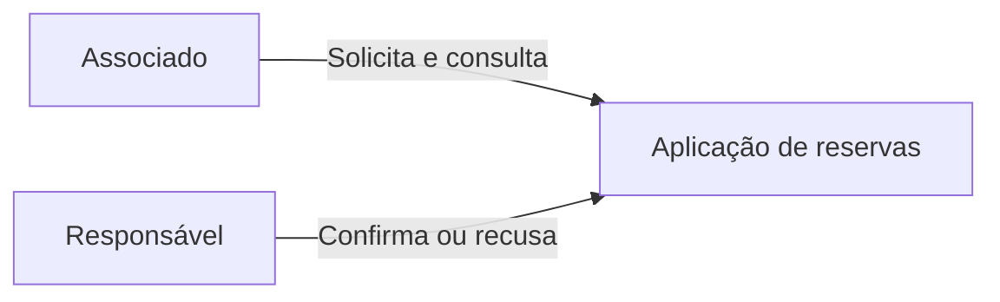
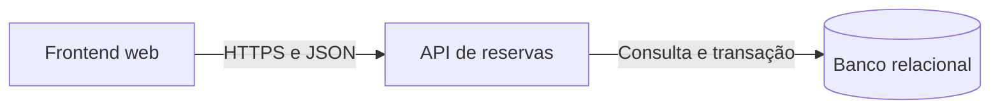
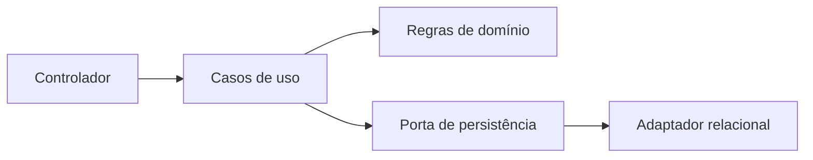
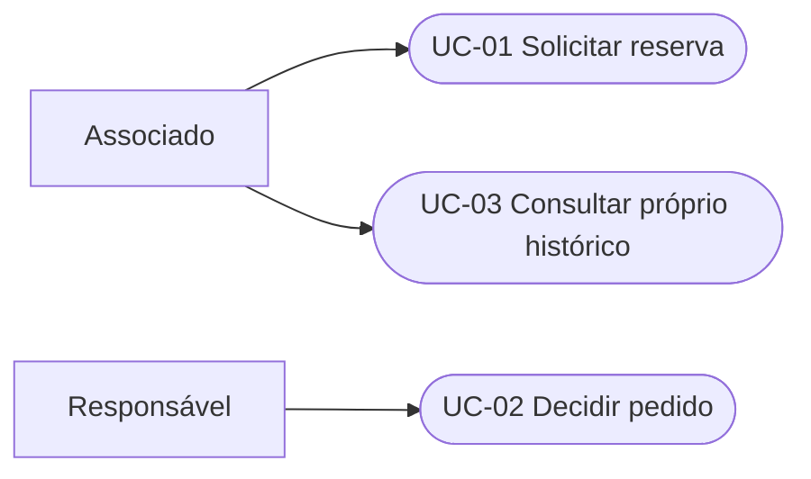
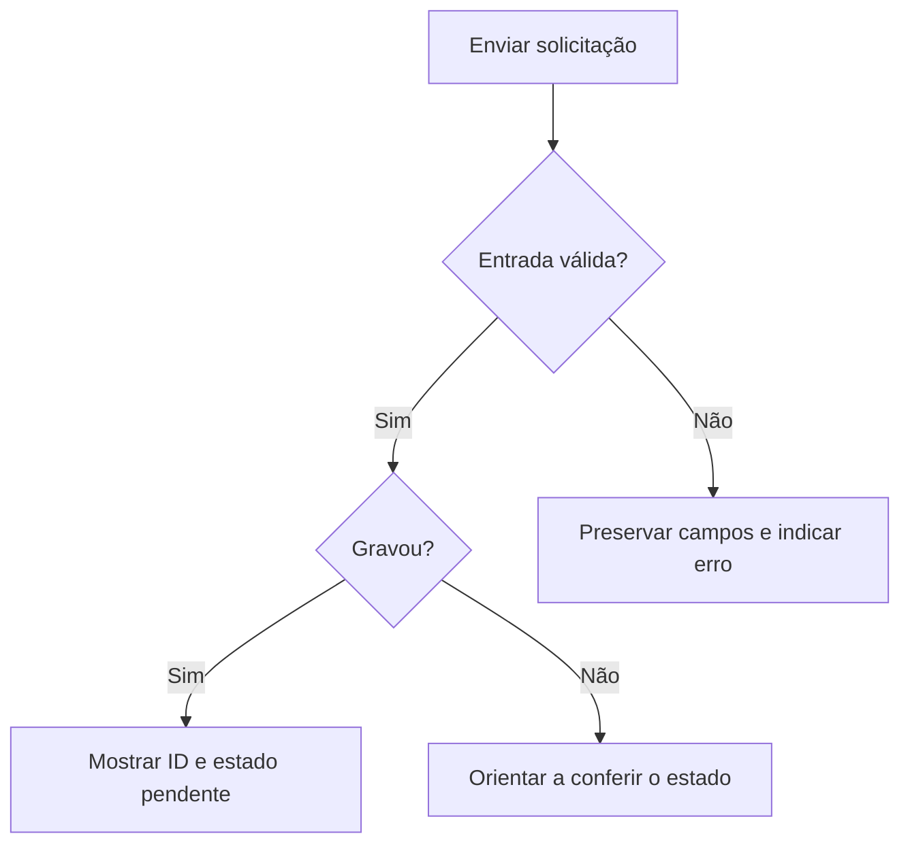
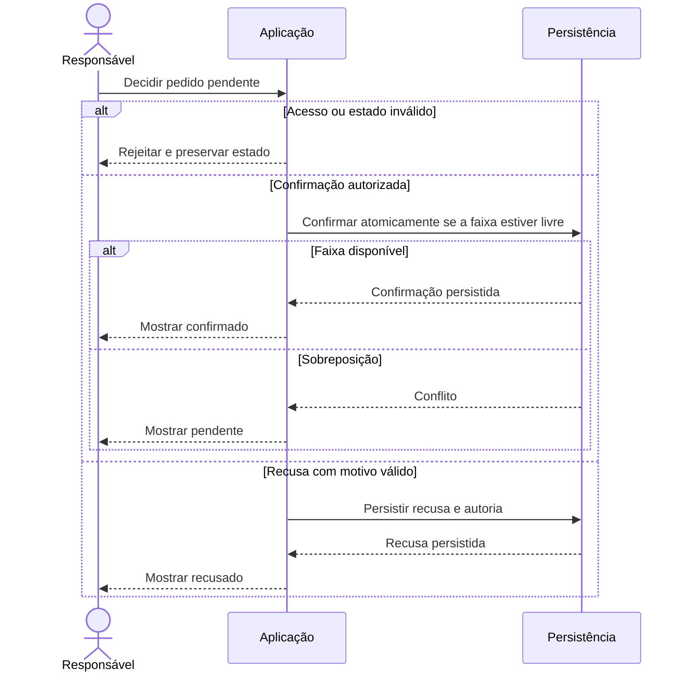
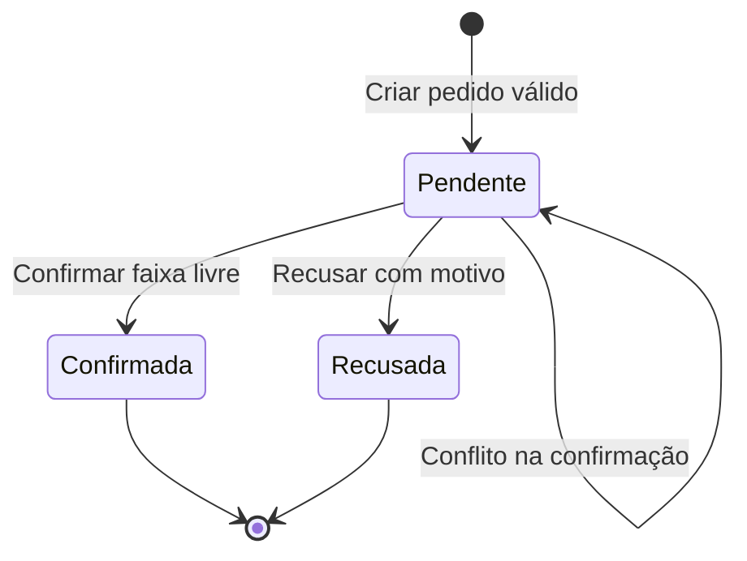
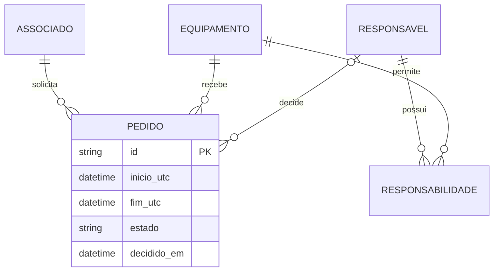
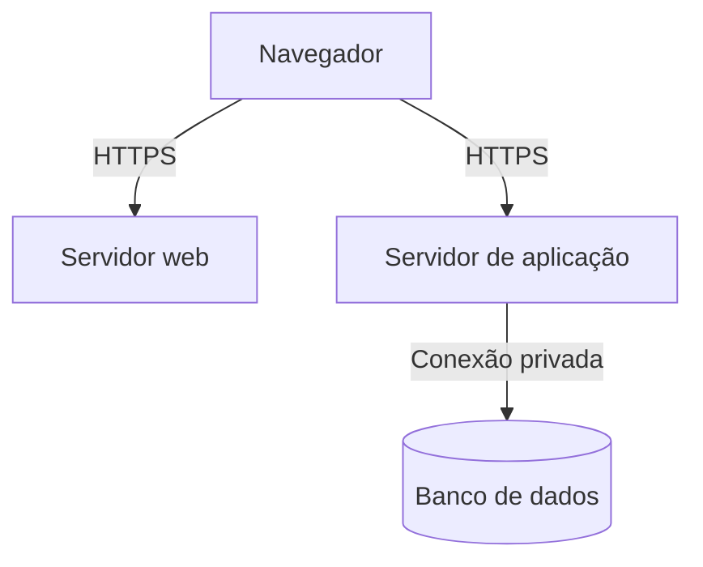
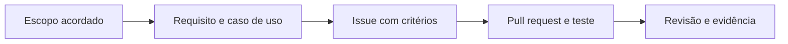

# Diagramas de reservas

As visões abaixo representam o caso fictício. Contêineres, componentes e implantação descrevem a solução proposta. Compare com a [especificação](especificacao.md) e o [ADR de concorrência](adr-001-confirmacao.md).

## Contexto

Quem participa e qual sistema tem a responsabilidade pela reserva?

## Contêineres

Que unidades de execução compõem a solução proposta?

## Componentes do backend

Onde ficam autorização, regra de domínio e persistência?

## Casos de uso

Que objetivos pertencem a cada ator? A representação usa Mermaid.

## Fluxo de solicitação

O UC-01 distingue entrada inválida, falha de gravação e sucesso.

## Sequência de decisão

O UC-02 mostra a transação na confirmação e a preservação do estado nos erros.

## Estados da reserva

Quais transições a aplicação permite a partir de pendente?

## Modelo de dados

Como pedidos, equipamentos e autorização por equipamento se relacionam?

## Implantação

Qual é a fronteira proposta entre cliente, aplicação e dados?

## Processo de trabalho

Como uma descoberta vira artefato e evidência no repositório de destino?

