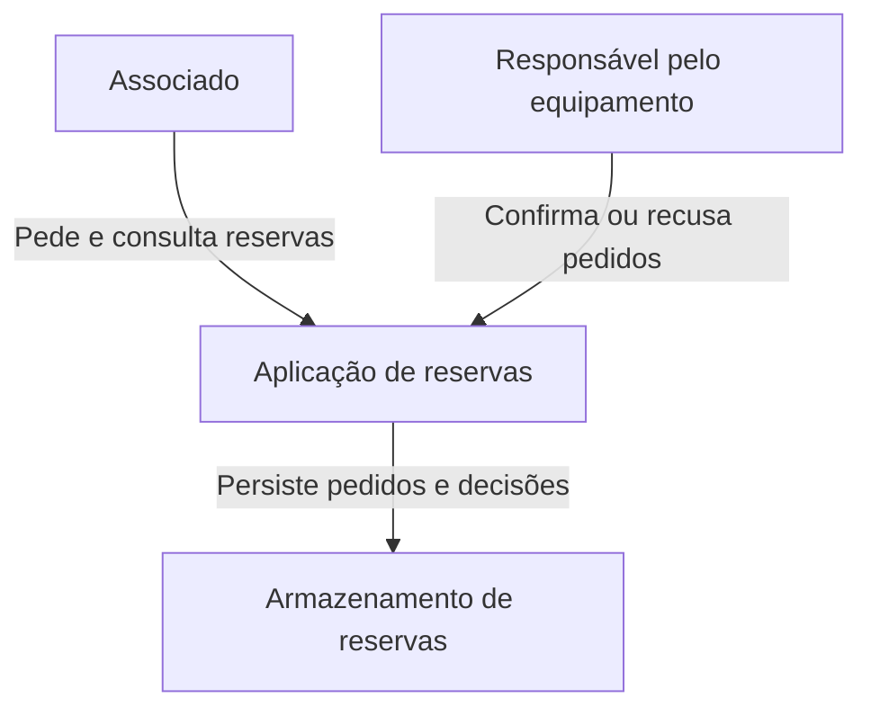
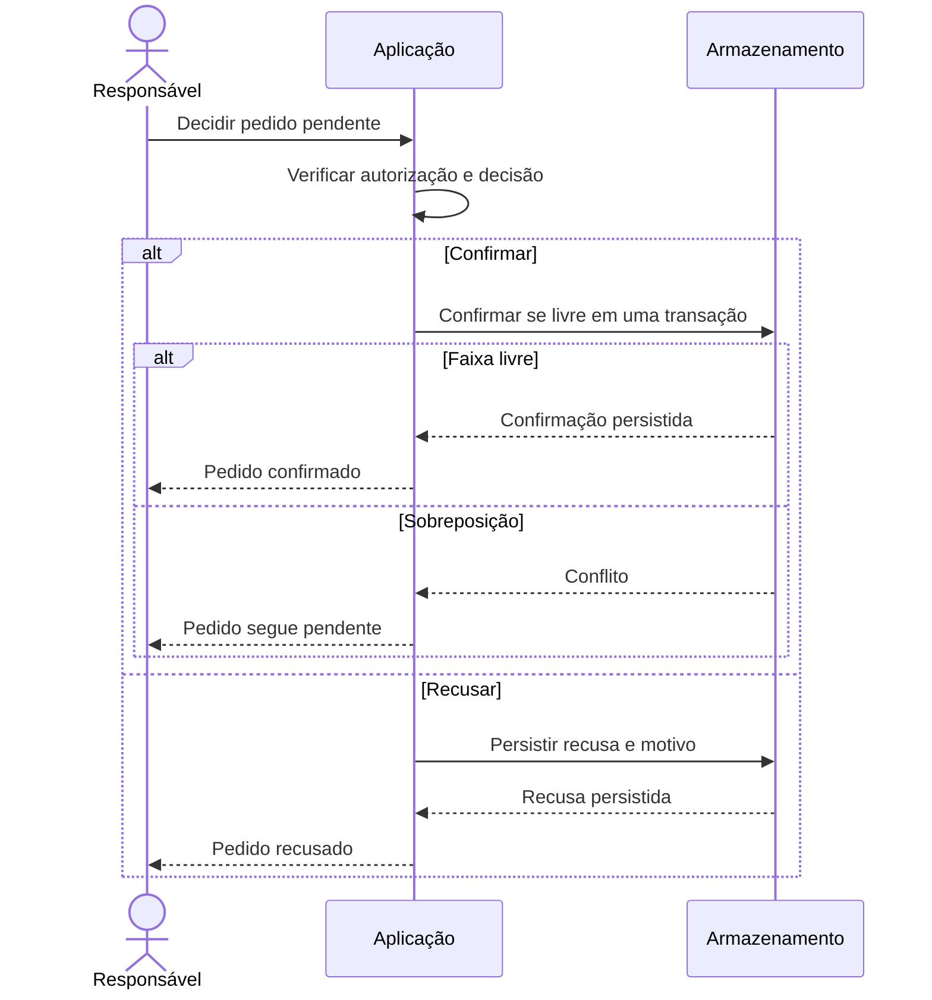

# Diagramas de reservas

## Contexto

Quem usa a aplicação e onde o estado das reservas é guardado?

## Sequência de decisão no UC-02

Em que momento a aplicação aplica a autorização e verifica a concorrência?

O diagrama supõe ator autorizado e entrada válida. Os cenários de acesso recusado e de fronteiras de horário estão no [plano de testes](especificacao.md#plano-de-testes).
