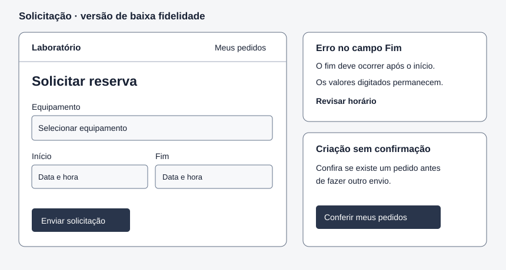

# Wireframes da solicitação

**Mini-escopo.** Testar se a pessoa consegue escolher um equipamento, preencher o intervalo e se recuperar de um erro ou de uma resposta incerta. O desenho é de baixa fidelidade e usa dados sintéticos.

| Estado | Comportamento para validar |
| --- | --- |
| Antes do envio | Navegar em ordem de leitura entre equipamento, início, fim e ação de envio |
| Erro de campo | Manter valores, explicar o erro em texto e mover o foco de modo previsível |
| Envio em andamento | Mostrar progresso em texto. Evitar novo clique durante a tentativa |
| Sucesso confirmado | Exibir identificador e pendente apenas após a confirmação de gravação |
| Resposta incerta | Oferecer consulta ao histórico e orientar uma nova tentativa só após conferência |

**Roteiro de avaliação.** Peça para uma pessoa solicitar uma faixa futura, corrigir um fim anterior ao início e explicar o estado após uma resposta incerta. Observe se ela encontra o campo, se entende o retorno e se confere o histórico. Registre dúvidas sem inventar resultado de sessão.

[Histórias e cenários](historias-e-cenarios.md) · [Fluxo detalhado](diagramas.md#fluxo-de-solicitação)
